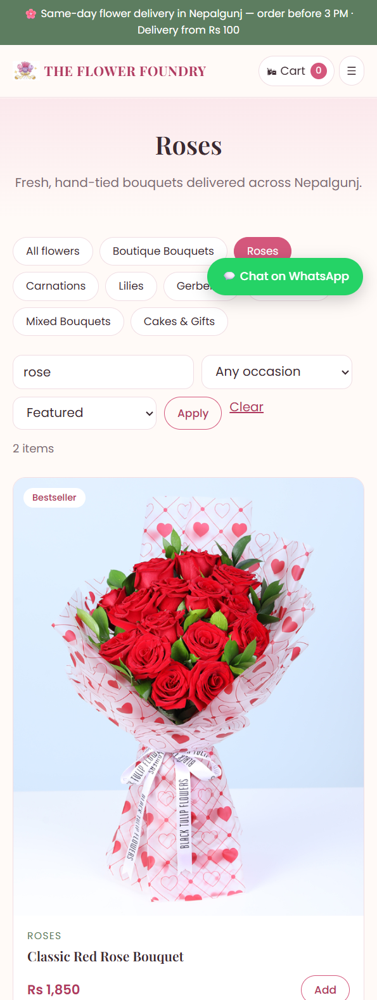
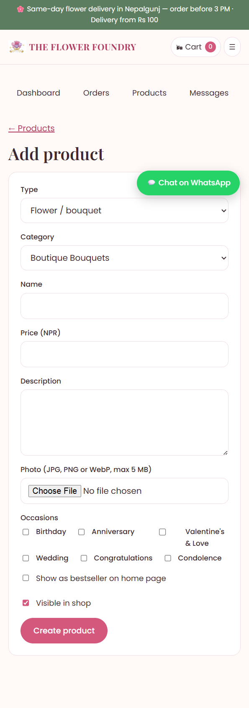
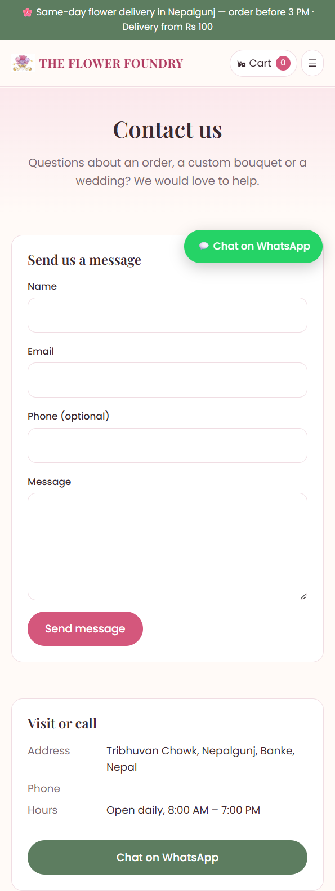
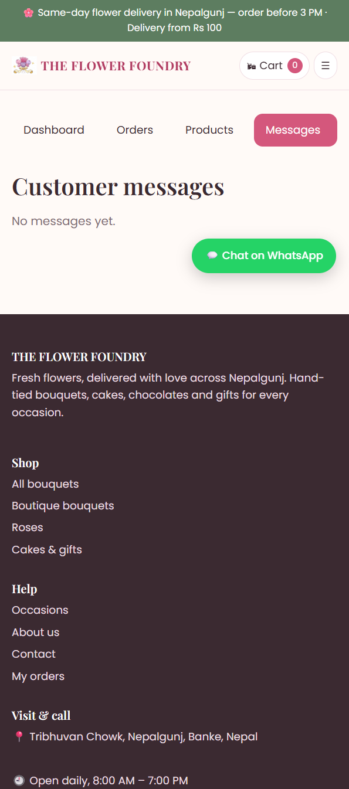

# THE FLOWER FOUNDRY

THE FLOWER FOUNDRY is a Nepalgunj flower shop built with PHP, MySQL, HTML, CSS, and JavaScript. It runs on XAMPP and does not require Node.js or Composer.

## Features

- Product catalog with search, category and occasion filters, details, and photos
- Customer accounts, login-protected cart, quantity editing, and cash-on-delivery checkout
- Delivery scheduling, card messages, and order history
- Admin dashboard for orders, product management, photo uploads, and customer messages
- SQLite-to-MySQL migration tool for existing local shop data
- URL generation supports a domain root or a subfolder installation

## Requirements

- PHP 8.1 or later
- MySQL or MariaDB, with a database and user created by the hosting control panel
- PHP extensions `pdo_mysql`, `fileinfo`, and `mbstring`
- A writable `data/uploads` directory for admin product photos

## Local setup with XAMPP

1. Install XAMPP and start Apache and MySQL.
2. Copy the project to `C:\xampp\htdocs\the-flower-foundry`.
3. In phpMyAdmin, create an empty database named `flower_foundry`.
4. Copy `config.example.php` to `config.php` and enter the local database settings. XAMPP's default local settings are host `127.0.0.1`, user `root`, and a blank password; never use those credentials on a public host.
5. From an XAMPP Shell, run setup:

   ```bat
   cd C:\xampp\htdocs\the-flower-foundry
   C:\xampp\php\php.exe setup.php
   ```

   Setup creates the tables if needed, seeds the 18 catalog products, and prompts for the first admin email and password when no admin exists. Use a unique password of at least 15 characters. The password is entered in the terminal, not stored in a source file.

6. Visit `http://localhost/the-flower-foundry/`.

`setup.php` connects only to the database selected in `config.php`; it does not create or select a database. You can also import `database/schema.sql` in phpMyAdmin before running setup. `php setup.php --schema-only` applies the table schema without seeding products or creating an admin.

## Deploy to a free PHP host

Choose a host that supports PHP 8.1+, MySQL/MariaDB, the required PHP extensions, HTTPS, and file uploads. Free-host capabilities and limits vary; verify them before uploading.

1. In the host control panel, create a database and database user, and grant the user access to that database.
2. Select that database in phpMyAdmin and import `database/schema.sql`. The schema intentionally contains no `CREATE DATABASE` or `USE` statement.
3. Upload the application files to the domain's document root (or a subfolder). Do not upload `.git`, `.env.local`, `data/shop.db`, or local `data/uploads` files.
4. Copy `config.example.php` to `config.php` on the host and enter the host's database host, database name, username, and password. Keep `config.php` private and never commit it.
5. Leave `base_url` blank when the app is installed at the domain root; it will be detected automatically. For a subfolder install, set it to the path, such as `/the-flower-foundry` (no trailing slash). Set `cookie_secure` to `true` when the site uses HTTPS. Set `contact_email` only if you want a public email shown on the contact page.
6. Ensure `data/uploads` exists and is writable by PHP, without making the rest of the project writable.
7. Visit `https://your-domain.example/setup-admin.php` and enter the admin email and a unique password of at least 15 characters. The password is stored as a hash, and the initial catalog is seeded if it is empty. This page returns 404 after an admin account exists; remove `setup-admin.php` from the web root after setup as an extra precaution.
8. Open the public site over HTTPS and test customer registration, cart/checkout, and the admin dashboard.

The root `.htaccess` blocks direct requests to configuration files on Apache hosts. Keep `config.php`, local databases, logs, and uploaded files out of the Git repository regardless.

## Demo flow

1. Open the shop, search for a flower, and filter by category.
2. Register a customer account, add a product, adjust the cart, and place a cash-on-delivery order.
3. Visit the customer account page to see the order.
4. Log in with the admin account created by setup; review the order and change its status.
5. Submit the Contact form and view the saved message under Admin → Messages. Admins can also upload product photos under Admin → Products.

## Screenshots

**Shop search and category filter**



**Admin product photo upload**



**Customer contact form**



**Admin messages section**



## Optional SQLite migration

To migrate the local `data/shop.db`, first create and configure an empty MySQL database, then import the schema and run:

```bat
C:\xampp\php\php.exe tools\migrate-sqlite.php
```

The migration stops if any target table already contains rows. It copies users and password hashes, sessions, products, orders, order items, and messages in a transaction; the SQLite source is not modified.

## Configuration and publish checklist

- `config.php` contains database credentials and optional deployment settings. It is ignored by Git.
- `config.example.php` is a blank template; copy it to `config.php` and edit the copy.
- `database/schema.sql` defines the MySQL tables. `setup.php` installs the schema and initializes an empty catalog/admin.
- `data/uploads` stores admin-uploaded photos and is ignored by Git.
- Checkout currently supports cash on delivery only. eSewa secrets are blank by default and must be configured privately before enabling any eSewa payment flow.
- The legacy Git commit contains a retired eSewa sandbox key in deleted Next.js files. Publish a clean initial snapshot instead of pushing the old commit history.
- Update sample reviews and shop details before launch. Keep customer/order data out of public repositories.
